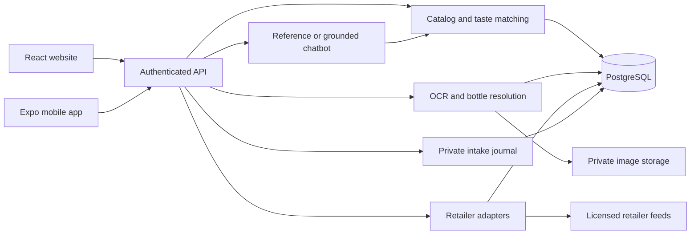

# WineWizard — consumer web and mobile architecture

## Product purpose

Help adults understand wine, find styles they may enjoy, keep their own bottle notes, locate retailer listings, and record consumption deliberately. The main journey is:

**Preferences → Explore or scan → Confirm bottle → Find nearby → Save or log a serving.**

Saving a bottle, rating it, and logging consumption are separate actions. The chemistry classifier stays in an optional educational lab; UCI chemistry classes and imputed lab measurements do not power consumer bottle identification or wellness advice.

## Recommended stack

| Layer | Recommendation | Reason |
|---|---|---|
| Web | React + TypeScript + Vite | Extends the existing React site; straightforward static hosting and component tests. |
| Mobile | React Native + Expo | Shared TypeScript domain logic, native camera/image picker and notifications; platform-specific screens where useful. |
| API | Node.js + TypeScript | One API for catalog, matching, scan processing, retailer adapters, notebook and journal. Keep privileged integrations on the server. |
| Primary database | Supabase PostgreSQL | Relational bottles, vintages, ratings, offers and drink entries; geographic queries with PostGIS, row-level security and managed storage. |
| Identity | Supabase Auth for a new deployment; Firebase Auth if already used | Choose one identity authority. Existing Node adapters support verified Firebase tokens plus server-side Supabase access. |
| OCR | Expo Camera/ImagePicker → ML Kit on native mobile; Tesseract.js in a browser worker; Cloud Vision for an optional server fallback | Capture and recognition are separate. Native ML Kit needs an Expo development build/native integration. Tesseract.js is useful for a prototype; curved labels and glare still require correction. |
| Images | Signed uploads to private object storage | Crop first, restrict file type/size, and avoid retaining original label images by default. |
| Notifications | Expo Notifications and browser notifications | Optional scheduled reminders with quiet hours. Request permission when the user enables reminders. |
| Chatbot | Reference answers first; later a server-side model grounded in trusted catalog documents | Ask questions about the current bottle, explain recommendation reasons, and cite sources. Journal access is separate and off by default. |
| Deployment | GitHub Pages for the current frontend; a separate Node host for APIs | The consumer deployment can move web/API together later. Never put database service keys or model API keys into frontend bundles. |

Technology references: [React](https://react.dev/learn/creating-a-react-app), [Expo Camera](https://docs.expo.dev/versions/latest/sdk/camera/), [Expo ImagePicker](https://docs.expo.dev/versions/latest/sdk/imagepicker/), [ML Kit](https://developers.google.com/ml-kit/vision/text-recognition/v2), [Tesseract.js](https://github.com/naptha/tesseract.js), [Cloud Vision OCR](https://docs.cloud.google.com/vision/docs/ocr), [Supabase row-level security](https://supabase.com/docs/guides/database/postgres/row-level-security).

## Architecture



Clients share schemas, matching and intake functions. They do not share every screen component: mobile scanning and web browsing have different layouts. The API performs authorization, input validation and integration calls; clients never supply a trusted owner ID.

Start with relational tables and explainable matching. Add semantic search or learned recommendation models only when the catalog and ratings justify them.

## Core data model

| Table | Important fields |
|---|---|
| `profiles` | owner ID, timezone, country, quiz preferences, notification preferences |
| `wine_products` | producer, name, grapes, style, source identifiers |
| `wine_vintages` | product ID, vintage, region, ABV, volume, sourced descriptors and field provenance |
| `catalog_entries` | owner ID, vintage/product ID or manual bottle, rating, notes, tried date, favourite flag |
| `scan_jobs` | owner ID, processing status, extracted fields, confidence, confirmed match, deletion time |
| `retailers` / `stores` | retailer ID, store ID, address, location, product URL |
| `offers` | retailer SKU, vintage/product mapping, price in minor currency units, currency, availability status, quantity if supplied, checked timestamp |
| `drink_entries` | owner ID, consumed UTC timestamp, volume mL, confirmed ABV, pure alcohol mL, definition/version, optional bottle ID |
| `reminders` | owner ID, schedule, timezone, quiet hours, enabled flag |

Place row-level security on personal tables. Keep intake records separate from collections and exclude them from public sharing. A product can have multiple vintages and retailer SKUs; do not resolve them by name alone. A manual bottle remains valid when no catalog match exists.

Store source and confidence at the field level. Separate **confirmed label facts**, **retailer/catalog facts**, **general wine-style education**, and **user notes**.

## Screen-by-screen flow

| Screen | Contents and next action |
|---|---|
| 1. Welcome | Product explanation, country/timezone and eligibility flow appropriate to the launch region. Guest browsing or account sign-in. |
| 2. Taste quiz | Flavour chips such as citrus, berry, floral, herbal or oak; body, sweetness, acidity, tannin and colour preferences. Include “not sure” and let people skip. |
| 3. Taste profile | Summarize preferences with editable controls. Explain that recommendations reflect taste, not quality or a guaranteed reaction. |
| 4. Explore | Search and filter catalog. Cards show a Match Percentage, descriptor coverage and short reasons. No score when the evidence is too sparse. |
| 5. Bottle details | Label facts, plain-English guide, tasting descriptors, source links and separate actions: Save, Rate, Find nearby, Log serving and Ask. |
| 6. Scan or upload | Camera permission at use, gallery upload and manual entry. Crop/rotate and handle glare or blurry images. |
| 7. Review scan | Show extracted grape, producer, region, vintage and ABV with confidence. Ask the user to correct uncertain fields; price is manual or from a retailer, not assumed from a label. |
| 8. Resolve bottle | Present plausible catalog/vintage matches. Confirm the exact bottle or continue with a manual entry. A scan does not authenticate it. |
| 9. Nearby stores | Postal code or optional foreground location. List/map with source, distance, retailer price, stock state and last check. |
| 10. Store listing | Address, hours if sourced, offer details and “Open retailer.” Begin with external retailer checkout rather than handling alcohol sales. |
| 11. My catalog | Tried/saved bottles, ratings, notes and filters. Rating updates taste preferences; duplicate saves do not imply additional consumption. |
| 12. Log a serving | Explicit amount in mL, time and confirmed ABV; a glass-size preset is editable. Show the calculated standard-drink amount before saving. |
| 13. Mindful journal | Weekly daily bars, known totals, entries needing ABV/volume, previous weeks and optional user-selected tracking goals. No “safe to drink/drive” indicator. |
| 14. Reminder settings | Optional hydration and journal reminders, local-time scheduling and quiet hours. Water does not subtract standard drinks or imply reduced alcohol risk. |
| 15. Ask WineWizard | Questions about wine terms, the current bottle or match reasons. Cite retrieved sources; say when bottle facts or stock are unknown. |
| 16. Account and privacy | Change country/timezone, edit quiz, manage permissions, export/delete private data and control scan retention. |

Mobile navigation: **Explore · Scan · Catalog · Journal**, with Ask accessible from bottle details and the home screen. Web uses the same sections in a sidebar/header.

## Taste Match Percentage

Use an explainable content-based score initially. Normalize sourced body, sweetness, acidity and tannin descriptors to 0–1; include colour and aroma overlap. Learn gradually from rated wines, with a quiz prior so one rating does not reshape the whole profile. Penalize close similarity to strongly disliked styles.

The shared `examples/product-logic.mjs` returns `matchPercentage`, `descriptorCoverage`, reasons and basis. The percentage is **taste similarity under this rule**, not a calibrated probability of liking a wine. Unknown descriptors are excluded; suppress the percentage when less than 60% of the desired descriptor weight is available. Do not populate bottle-specific descriptors from the educational chemistry model.

Validate the algorithm using held-out user ratings: rank liked bottles above disliked bottles, compare with a quiz-only baseline, inspect new-user performance and test missing metadata. Version weights and record the recommendation inputs so scores are explainable. A learned model is a later option once there is enough representative data.

## Scan pipeline

1. Crop/compress the photo on the client and recognize text locally where practical.
2. Upload only if server fallback is requested; store the image privately for a short disclosed retention period.
3. Extract structured candidates using dictionaries, patterns and provenance, e.g. `13.5% alc./vol.` for ABV and a plausible vintage year.
4. Search catalog candidates using producer/name, grape, region and vintage together. Barcode/retailer SKU can improve identification when available.
5. Let the user confirm the candidate and uncertain fields. Missing price remains unknown until entered or supplied by a retailer.
6. Generate educational explanations from confirmed fields and sourced reference material.

OCR reads text; it does not measure chemistry, nutritional sugar or wine quality. Avoid silently correcting an ambiguous ABV because the tracker later relies on it.

## Stock locator integration

Use provider-specific adapters behind a common response:

```js
{ wineVintageId, retailerSku, storeId, priceMinor, currency,
  availability: 'in_stock' | 'out_of_stock' | 'unknown',
  quantity: null, checkedAt, sourceUrl }
```

Connect one retailer/region first through a documented or licensed feed. If no approved feed exists, show links to retailer availability pages and an unknown inventory state. Cache appropriately, respect provider limits, and never turn missing data into “out of stock.” Prevent an exact-vintage match from becoming a generic product match without telling the user.

LCBO's own website/app displays store availability, but this does not establish an open third-party API entitlement: [LCBO FAQs](https://www.lcbo.com/content/lcbo/en/corporate-pages/faq.html). A partner feed and access terms need to be resolved separately.

## Intake tracker logic

For the Canadian default:

`standard drinks = serving volume mL × ABV / 100 ÷ 17.05`

For example, 150 mL at 13.5% ABV is approximately **1.19 Canadian standard drinks**. Canada's standard drink contains 17.05 mL of pure alcohol: [CCSA final guidance](https://www.ccsa.ca/sites/default/files/2023-01/CCSA_Canadas_Guidance_on_Alcohol_and_Health_Final_Report_en.pdf).

The sample preserves calculation precision, uses the user's timezone for day/week boundaries, handles daylight saving, treats incomplete entries as unknown, and normalizes the chart to one selected standard-drink definition. Country definitions and guidance should be versioned and reviewed using local authoritative sources. Store the original volume/ABV so a future country change can recalculate consistently.

Reminder schedules are opt-in general prompts. They do not alter recorded alcohol totals or imply that hydration cancels alcohol-related risk. The journal records intake; it is not a medical assessment, blood-alcohol estimator or driving clearance tool. Provide contextual links to [current CCSA guidance](https://www.ccsa.ca/en/guidance-tools-resources/substances/alcohol/canadas-guidance-alcohol-and-health).

## Component and API structure

```text
apps/web/                 React screens and web adapters
apps/mobile/              Expo screens and native adapters
packages/domain/
  taste-match.ts           normalized profile, similarity, coverage
  intake.ts                units, serving calculations, local-week totals
  schemas.ts               shared validation and data types
services/api/
  catalog/                 products, vintages, provenance
  scans/                   OCR jobs and bottle resolution
  recommendations/         match scores and explanations
  retailers/               independent inventory adapters
  notebook/                private saves and ratings
  journal/                 private consumption records
  assistant/               sourced reference/model answers
```

Example endpoints: `GET /catalog`, `POST /match`, `POST /scans`, `PATCH /scans/:id/confirm`, `GET /offers`, `POST /catalog-entries`, `PATCH /catalog-entries/:id`, `POST /drink-entries`, `GET /journal/weekly`, `POST /chat`. Enforce the owner on the server and validate every OCR/user input.

## Delivery stages and current state

1. **Foundation:** React web, reference chatbot, manual bottle guide, notebook and account/database integration.
2. **Personalization:** real catalog, quiz, ratings and explainable matching.
3. **Convenience:** scanner with corrections and one approved retailer integration.
4. **Mindful journal:** private serving logs, regional definitions, charts and opt-in reminders.
5. **Mobile:** Expo clients using the same domain functions and APIs.

Implemented in the web repository: React frontend, interactive quiz, ten sourced educational style profiles, explainable matching influenced by ratings, a local bottle notebook, Tesseract.js image recognition with editable field review, weekly intake charts and optional reminders while the page is open. The bottle guide, reference chatbot, chemistry lab, tested Node/SQLite API and optional Firebase/Supabase adapters also remain available.

The public site runs without an account and stores consumer records in this browser. Its chatbot uses reference answers and flags questions that require fresh verification. A server-only OpenAI web-search adapter is implemented and tested with mocks, but no live API account is configured or verified. Firebase/Supabase also need configuration and live verification. Exact commercial-bottle catalog matching, live inventory feeds, cloud journal sync and the native mobile app are future work. The app links to retailers and explicitly does not check real-time local stock.
